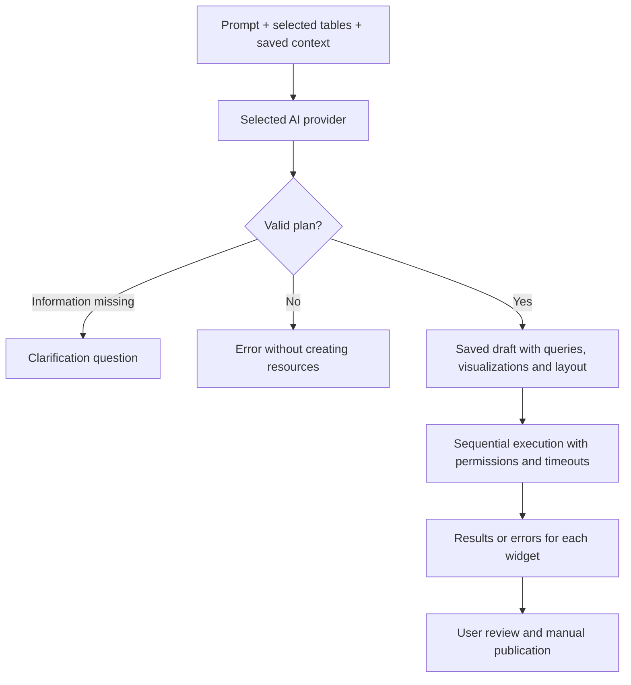

# Bi-Dash — User Guide

**For readers, editors and administrators · Updated November 8, 2026**

Bi-Dash is a workspace for connecting databases, writing queries, visualizing results and sharing reports. It extends the open-source Redash foundation with an AI assistant, automatic draft dashboards, configurable AI providers, persistent business context and explicit user roles with execution limits.

This guide describes the implementation in this repository. Button names match the English interface. Available controls depend on your role, groups and administrator policies.

## Contents

1. [Inherited features and Bi-Dash improvements](#comparison)
2. [Key concepts](#concepts)
3. [Quick start by role](#quick-start)
4. [Connecting a data source](#sources)
5. [Creating a report manually](#manual)
6. [Visualizations and dashboards](#dashboards)
7. [AI Assistant: Ask AI](#chat)
8. [AI Assistant: Build dashboard](#builder)
9. [Writing effective prompts](#prompts)
10. [Persistent AI Context](#context)
11. [Choosing and configuring an AI provider](#providers)
12. [Admin, Editor and Reader](#roles)
13. [Duration, concurrent queries and Limit 1000](#limits)
14. [Refreshing, downloading and sharing](#sharing)
15. [Privacy and data storage](#privacy)
16. [Troubleshooting](#troubleshooting)
17. [Recommended workflow](#workflow)
18. [Installation and further documentation](#references)

<a id="comparison"></a>
## 1. Inherited features and Bi-Dash improvements

The comparison uses the upstream source snapshot imported on November 6, 2026, recorded in [UPSTREAM_SOURCE.json](UPSTREAM_SOURCE.json). It does not describe every Redash version, commercial offering or other fork.

| Area | Inherited Redash foundation | Added or improved in Bi-Dash |
| --- | --- | --- |
| SQL and sources | Query editor, schema browser and connectors | Existing connections and workflows retained; AI builder uses the available schema |
| Reports and dashboards | Saved queries, visualizations, widgets and layouts | A prompt creates an actual draft dashboard with queries and visualizations |
| AI conversation | Not included in the imported foundation | Larger, more readable AI panel, SQL explanations and query suggestions |
| AI providers | No equivalent configuration in the imported foundation | Ollama, OpenAI, Anthropic and OpenAI-compatible APIs through Settings |
| Business context | No dedicated AI context section | Organization context saved once and automatically included in AI requests |
| Access | Groups, source permissions and resource permissions | Explicit Admin / Editor / Reader roles provide an additional permission boundary |
| Reader | Existing permissions and groups | Results without SQL, query keys, schema access or execution privileges |
| Editor controls | Existing jobs and deployment timeouts | Organization limits, stricter individual limits, running + queued job accounting and controls for AI, scheduling, sharing and archiving |
| Export | Inherited download formats | Administrators can disable Reader downloads |
| Row counts | Optional query editor auto-limit | No additional automatic row limit for AI queries; use the existing checkbox when needed |
| Installation | Inherited server architecture | Local Docker configuration with PostgreSQL, Redis and Ollama |
| Identity | Upstream branding and assets | Bi-Dash interface, Rising Signal logo and appropriate copyright/license notices |

Standard features such as parameters, favorites, tags, refreshing, alerts and API access remain part of the inherited platform. Availability depends on connectors, installed components and permissions. These are not all new Bi-Dash features.

<a id="concepts"></a>
## 2. Key concepts

| Term | Meaning |
| --- | --- |
| **Data Source** | A connection to a database or another supported source, including its address, credentials, connector type and permitted groups |
| **Query** | A saved request to a source, usually SQL, with a name and optional parameters |
| **Result** | Data returned by a particular execution; saved results may be older than the current database contents |
| **Visualization** | A table, chart, counter or another presentation of a result |
| **Dashboard** | A page containing one or more widgets, visualizations and optional text |
| **Report** | In this guide, a query with a visualization or a dashboard answering a business question; not necessarily a PDF document |
| **Draft** | An unpublished resource awaiting review; not a separate private workspace with its own access rules |
| **Role** | The upper boundary of permitted actions: Admin, Editor or Reader |
| **Group** | A way to organize source access; a role does not replace group permissions |

An accurate report needs both technically correct SQL and the right business definition. For example, “sales” could mean tax-inclusive totals, net revenue, paid invoices or confirmed orders.

<a id="quick-start"></a>
## 3. Quick start by role

### Reader

1. Sign in at your Bi-Dash installation address.
2. Open an available dashboard from **Dashboards** or a team link.
3. Check when its results were refreshed.
4. Browse, sort and use the available table filters.
5. Download results if the administrator permits it.

If no saved result exists or you need fresh data, ask an Editor to refresh the report. Readers do not execute SQL.

### Editor

1. Check that you can access the required source and execute queries.
2. Create a report manually or through **AI Assistant → Build dashboard**.
3. Review the SQL, results, aggregation and visualizations.
4. Save the report with a clear name and description.
5. Add it to a dashboard and publish when ready and permitted.

### Admin

1. Connect and test Data Sources.
2. Configure groups and source access.
3. Assign roles through **Settings → Users**.
4. Set policies under **Settings → Roles & Access**.
5. Configure **AI Configuration** and save **AI Context** if AI will be used.
6. Prepare at least one verified report with saved results for Readers.

<a id="sources"></a>
## 4. Connecting a data source

An administrator performs these steps:

1. Open **Settings → Data Sources** and add a source.
2. Choose the appropriate connector.
3. Enter a descriptive name, **Host**, **Port**, **User**, **Password**, database name and any required SSL settings.
4. Save and use **Test Connection**.
5. Assign access through groups.
6. Open the query editor and check that the table schema loads.

**The MySQL connector also supports compatible MariaDB servers.** The MySQL label identifies the connector, rather than guaranteeing the remote database product. When the connection works, check the server version with `SELECT VERSION();`.

Source **Full access** and **View Only** permissions combine with the user role. A Reader does not gain SQL or execution access merely because a group has Full access. The AI builder requires an active, permitted source with query access.

The schema browser uses a cache. Visible tables do not prove that the connection still works. Refresh the schema after schema changes; retest the connection after changing the address or credentials.

The regular query editor supports more connectors than the AI builder. Automatic AI creation currently supports PostgreSQL and MySQL/MariaDB.

<a id="manual"></a>
## 5. Creating a report manually

1. Choose **New Query** from the creation menu.
2. Select a Data Source.
3. Inspect tables and columns in the schema browser.
4. Write a query using the source's SQL dialect.
5. Decide whether to enable **Limit 1000**.
6. Run the query and check results and errors.
7. Save it with a clear name, such as “Monthly net sales — confirmed orders”.
8. Add a visualization or include it in a dashboard.

**MySQL/MariaDB example using a fictional schema**, `orders(created_at, status, total)`:

```sql
SELECT
    DATE_FORMAT(created_at, '%Y-%m') AS sales_month,
    SUM(total) AS revenue
FROM orders
WHERE status = 'completed'
GROUP BY DATE_FORMAT(created_at, '%Y-%m')
ORDER BY sales_month;
```

Adapt names and statuses to the real database. PostgreSQL uses functions such as `date_trunc`; SQL is not automatically portable between all connectors.

Before saving, check the reporting period, time zone, tax treatment, reversals and whether joins duplicate amounts.

<a id="dashboards"></a>
## 6. Visualizations and dashboards

Manual editing offers the visualizations available in your installation. The AI builder creates this subset:

| Type | Useful for |
| --- | --- |
| **Table** | Detailed rows, validation, lists and rankings |
| **Bar** | Comparisons by product, category, store or another segment |
| **Line** | Trends over time in chronological order |
| **Pie** | Shares of a whole with a small number of categories |
| **Counter** | One numeric value, such as total sales or order count |

In the visualization editor, choose the category/date for X and numeric columns for Y. Configure number formats, legends, titles and other available options. Do not add different currencies into one counter without a defined conversion.

For a manual dashboard, create **New Dashboard**, add saved visualizations, arrange and resize widgets, add descriptions or text, and save. Widgets can use different sources; users need the appropriate access to their data.

Publishing a dashboard and creating a **public link** are separate actions. Public sharing requires its own permission. An unpublished draft is not necessarily visible only to its author.

<a id="chat"></a>
## 7. AI Assistant: Ask AI

**Ask AI** is a conversation for SQL questions, query analysis and explanations. It does not itself create dashboards or execute suggested queries.

1. Open **AI Assistant** and choose **Ask AI**.
2. Write a specific question.
3. If needed, expand **Extra context for this conversation** and add relevant schema or details.
4. Submit with **Send** or **Ctrl / ⌘ + Enter**.
5. Read the answer. Review any proposed SQL before running it in the query editor.

Examples:

> Explain why this JOIN could duplicate sales. Keep the table names unchanged.

> Write a MySQL query for daily sales from confirmed orders. Use the supplied schema and ask if the amount definition is missing.

**Copy SQL / answer** copies the recognized SQL block or the answer. **Clear chat** clears the conversation. Reloading loses the panel conversation; saved organization AI Context remains.

Chat does not automatically inspect the entire database. It answers using the submitted question and context. Accuracy also depends on the selected model.

<a id="builder"></a>
## 8. AI Assistant: Build dashboard

Use this mode to create actual reports without copying SQL from a chat answer.

### Steps

1. Open **AI Assistant → Build dashboard**.
2. Select a Data Source. Available active PostgreSQL and MySQL/MariaDB sources with appropriate access are listed.
3. Under **Relevant tables**, choose up to **12** tables needed for the report. Exact names and columns from the cached schema are added automatically.
4. Describe metrics, period, grouping, filters and desired visualizations.
5. Click **Create draft dashboard** and wait.
6. Review each query's status: preparing, queued, running, ready or a specific error.
7. Select **Open draft dashboard**.
8. Review SQL, data, charts and business assumptions. Edit as needed, then publish.

### How it works



The model proposes a structured plan; Bi-Dash validates it and creates resources. Permissions are checked again after the AI response. Automatic queries are single read-only SELECT/CTE statements with a restricted function allowlist, and the connector uses a read-only transaction. An invalid plan does not create a partial dashboard.

### Capabilities and limits

- Up to **6 visualizations** per generation: table, bar, line, pie or counter.
- The builder does not automatically publish, schedule or create public links.
- There is no additional automatic 1,000-row limit. New AI queries have auto-limit disabled. Use the query editor checkbox when needed.
- An explicitly requested “top 10” or another SQL `LIMIT` has its own meaning and remains when the checkbox is disabled.
- Each AI query has a maximum duration of **60 seconds**, or a shorter applicable user/deployment limit.
- Selected tables guide the model; they do not create a new security boundary. Authorization comes from Bi-Dash permissions and database credentials.
- If expected chart column names do not match the result, the builder may fall back to a table and report this in the status.

### If a query fails

The saved draft remains, and the affected widget shows its error. Fix the cause and use **Retry report results**, or open the query in the editor. Retry reruns that draft without creating another dashboard for the same request ID. A new prompt or session may create a new draft.

Keep the page open during generation and sequential execution. Closing the drawer preserves its state, but reloading or navigating may interrupt remaining browser steps. Already saved resources and submitted jobs remain.

<a id="prompts"></a>
## 9. Writing effective prompts

Include **metric + period + filters + grouping + visualization + definitions that must not be assumed**.

### Monthly, weekly and daily sales

> Create a dashboard with three line charts for monthly, weekly and daily net sales in 2026. Include only confirmed orders. Exclude cancelled orders and deduct reversals according to the saved context. Weeks start on Monday. Use the Europe/Skopje business time zone. Sort dates ascending. Do not add a row limit. If the schema or context does not define net sales, ask before preparing the plan.

This instructs the model; it does not guarantee correct weekly grouping or time zone conversion without review. Required columns and definitions must exist.

### Management overview

> Create a draft with a counter for total net revenue in the selected period, a bar chart by category and a table of the top 10 products by revenue. Use one currency for all amounts. Do not confuse product counts with order counts.

### Data validation

> Create a table with daily order counts and total amounts. Include a count of rows without a date. Do not assume a JOIN unless the relationship between the selected tables is defined in the context.

Avoid vague requests such as “make sales with a chart”. With a small local model, request fewer widgets and select only relevant tables. For SQL beyond the builder's supported features, use Ask AI and review it manually.

<a id="context"></a>
## 10. Persistent AI Context

**Settings → AI Context** is a dedicated administrator section for shared business definitions. Context is saved per organization, applies to chat and builder requests, and survives restarts. Saved text is limited to **24,000 characters**; the amount a model can process also depends on its context window.

Adapt this example to your real database:

```text
SQL dialect: MySQL/MariaDB.
Preserve all table names and prefixes exactly.

Sales = net amount from confirmed orders.
Exclude cancelled orders.
Net amounts exclude VAT. Currency: MKD.
Reversal definition: [enter the exact business logic].

Weeks start on Monday.
Database dates are stored in: [enter the actual time zone].
Order-to-item relationship: [table.key = table.key].

Ask when a definition is missing. Do not invent columns or relationships.
```

Replace placeholders with accurate definitions, amount fields, statuses and keys. Context guides the model; it does not grant access or protect the database. Do not enter passwords, API keys or unnecessary personal data.

Extra context in Ask AI applies to the current conversation. It does not replace or update persistent organization context.

<a id="providers"></a>
## 11. Choosing and configuring an AI provider

An administrator opens **Settings → AI Configuration**, selects a provider, enters the exact **Model ID**, address when applicable and their own **API key** when required, then clicks **Save**.

| Option | Configuration | Suitable for |
| --- | --- | --- |
| **Ollama** | Installed Model ID and a server-accessible address | Local model execution without a paid API key |
| **OpenAI** | Model ID available to the account and its API key | Hosted models billed by the provider |
| **Anthropic** | Appropriate Claude Model ID and API key | Hosted models billed by the provider |
| **Other / OpenAI-compatible** | Model ID, API base URL and optional service key | Compatible local servers, gateways or hosted APIs |

Flexibility is at the API protocol level. Arbitrary agent endpoints may need an adapter. The compatible option expects an OpenAI Chat Completions-compatible interface.

Enter a compatible service's base URL including its version path, such as `https://provider.example/v1`, **without** `/chat/completions`; Bi-Dash appends that path. The `.example` address is illustrative, not a working provider.

The local Docker configuration uses `http://ollama:11434`. For Ollama on the Windows host, containers normally use `http://host.docker.internal:11434`. Inside a container, `localhost` does not refer to the Windows host.

Entering a model name does not download it. For the model used by the local configuration:

```powershell
docker compose -f compose.local.yaml exec ollama ollama pull qwen2.5-coder:7b
```

Provider profiles are retained when switching providers. A blank key field keeps the saved key for that profile; a new key replaces it, and **Remove the saved API key** deletes it. Changing a compatible base URL requires entering the key again so an old key is not sent to a different address.

Provider selection is explicit: if Ollama fails, Bi-Dash does not automatically switch to a paid provider. Hosted profiles require valid credentials and provider quota. The project does not include someone else's API key or a free hosted account.

<a id="roles"></a>
## 12. Admin, Editor and Reader

| Capability | Admin | Editor | Reader |
| --- | --- | --- | --- |
| Manage users, roles, sources and AI settings | Yes, within the organization | No | No |
| View SQL and schema | Yes | Subject to source access | No |
| Create and edit reports | Yes | Own resources or resources with edit access | No |
| View available results | Yes | Yes | Yes |
| Execute fresh queries | Yes, subject to deployment limits | Subject to limits and access | No |
| Download | Yes | Yes | Enabled by default; Admin can disable it |
| AI Assistant and builder | Yes | Enabled by default; Admin can disable it; other permissions still apply | No |
| Scheduling / public sharing / archiving | Yes | Disabled by default; configured by Admin | No |

### Assigning roles

In **Settings → Users**, select a role when creating a user, or open a profile and **Role & query limits**. Save changes. New invitations and new SSO users default to Reader; an Admin can promote them.

Existing accounts without an explicit role are interpreted using inherited groups: Admin if they have administrator permission, otherwise Editor. This compatibility rule does not replace reviewing existing accounts.

Group access cannot exceed an explicit role. A Reader in an administrative group does not become an Admin. Editors cannot promote themselves or assign edit grants to other users; administrators manage these permissions.

### What Readers see

Readers receive results without SQL, query hashes or query API keys. They cannot access SQL query lists, the schema browser, query snippets, AI or modification endpoints. Restrictions are enforced by the backend, as well as the interface.

Readers use previously computed results. Paging, sorting and table filters operate on loaded data. Changing parameters may return a saved result for that exact combination; otherwise an Editor must execute the query. Reader refresh does not create a database job.

Disabling downloads does not remove access to permitted report data. Users can still read it through the normal interface/API.

<a id="limits"></a>
## 13. Duration, concurrent queries and Limit 1000

These controls address different concerns:

| Control | What it limits | Default / range |
| --- | --- | --- |
| **Maximum query duration** | Duration of an execution | Editor: 60 seconds; organization setting: 1–3,600 seconds |
| **Maximum concurrent queries** | Running or queued jobs per user | Editor: 2; organization setting: 1–20 |
| **Limit 1000** | Optional query editor auto-limit | Selected per query; not an additional hardcoded AI limit |

Admin sets the first two controls in **Settings → Roles & Access**. A profile can impose stricter limits on an individual Editor; blank fields inherit policy. A larger individual value cannot relax a stricter organization limit.

For example, an organization allows 60 seconds and 2 jobs. A new Editor is assigned 20 seconds and 1 job, so 20/1 applies. A profile value of 120 seconds still cannot exceed the organization limit of 60. The AI builder has its own 60-second maximum even when a user's ordinary queries may run longer.

Queued jobs count toward the quota: two queued queries may occupy a limit of 2. HTTP 429 means you need to wait or cancel your own work when that option is available.

At timeout, the worker interrupts the job; PostgreSQL also receives a native statement timeout. Other remote databases depend on their connector's cancellation behavior. Limits do not undo actions that have already completed. Policy changes do not retroactively shorten a job's already accepted timeout.

**Limit 1000** is not a timeout or a guarantee of low cost: a small result can require scanning substantial data. Disabling it does not remove a `LIMIT` written in SQL or restore rows excluded by WHERE, GROUP BY or other conditions. Rerun and save after changing the setting to obtain updated results.

<a id="sharing"></a>
## 14. Refreshing, downloading and sharing

### Freshness and parameters

Saved dashboards may display previous results. Check the refresh time before making a decision. Editors/Admins with source access can execute fresh queries; Readers use available saved results.

Define query parameters in the editor using appropriate types. The builder initially generates queries without parameters; subsequent manual edits follow the platform's normal rules.

### Download

Use the query/visualization download menu, when available, to export **CSV**, **TSV** or **Excel (.xlsx)**. Export contains the particular query result, rather than the entire database or a screenshot of the dashboard. It cannot reconstruct rows excluded by SQL or auto-limit.

### Internal sharing

Share report or dashboard links with organization members. A link does not grant access to otherwise restricted sources. Editing someone else's resource requires the appropriate Admin-assigned edit grant.

### Public links and scheduling

Public sharing is separate from **Publish** on a draft. Use it only when permitted and appropriate for the results. Editors have public sharing, scheduling and archiving disabled by default; Admin can enable them independently.

Scheduled refresh executes a query; it does not generate a new AI plan. The owner's continuing scheduling permission is checked. Alerts and destinations are configured separately and depend on installed integrations and permissions.

<a id="privacy"></a>
## 15. Privacy and data storage

- **AI provider:** Receives the prompt, included context and relevant schema. Chat also sends content you paste into the conversation. The builder does not send query result rows back to the model.
- **Local model:** Ollama is local only if its configured endpoint is local. A remote address sends requests to that address.
- **Hosted model:** Processing, retention and billing depend on the provider and your account agreement.
- **API keys:** Saved keys are encrypted on the server and are not returned as plaintext in Settings. Backup/restore must preserve the appropriate server secret for decryption.
- **Drafts:** Remain organization resources under normal access rules. “Unpublished” does not guarantee author-only privacy.
- **Local Docker storage:** The PostgreSQL volume stores users, reports and settings; the Ollama volume stores models. The drawer conversation is not persistent chat history.
- **Usage data:** Inherited optional telemetry is separate from AI and, when enabled, goes to the upstream analytics endpoint. The interface identifies the actual recipient; this is not a Bi-Dash hosted analytics service.

Source code and GitHub alone are not a backup. Preserve the metadata database and relevant server secrets/configuration. Do not publish `.env`, database dumps, private keys or real credentials to GitHub.

<a id="troubleshooting"></a>
## 16. Troubleshooting

| Symptom | Meaning / next step |
| --- | --- |
| **Host is not allowed / 1130** | The server rejected the displayed client address. Check the database Host, permitted access and whether the provider changed its IP. The database address and connecting client address have different roles |
| **Access denied** | Check user/password, database, host-specific grants and SSL requirements. Do not put credentials in AI Context |
| Tables are visible but queries fail | Schema may be cached. Run Test Connection and check source/worker access |
| Source missing from Build dashboard | Check PostgreSQL/MySQL type, paused state, role, AI permission and Full query access through a group |
| Schema cannot load | Check connection, schema worker and table access for the database user |
| **AI provider is not configured** | Admin must save a valid provider, Model ID, URL and key when required |
| Provider error / 502 | Check endpoint reachability from the Bi-Dash server, Model ID, API protocol and provider status; read the specific error |
| AI timeout / 504 | The model did not respond in time. Reduce context/tables/widgets and check CPU/RAM; ask Admin to review AI and web-worker timeouts |
| **429 / query limit reached** | Wait for running/queued work to finish. A separate hosted AI 429 may mean a provider rate limit or exhausted quota |
| Query timeout | Shorten the period, optimize joins/conditions, check indexes or ask Admin to review policy |
| Invalid AI plan | The model returned unsupported structure/SQL. Refine the prompt, request fewer widgets or use a more suitable model |
| One widget fails | The draft remains. Open its query, check SQL/connection, then retry or run manually |
| Chart becomes a table | Output aliases did not match expected chart columns. Configure a suitable visualization after reviewing the result |
| Reader cannot obtain fresh data | An Editor/Admin must compute the result, including the requested parameter combination |
| Download missing | Check Reader download policy and result availability |
| Still only 1,000 rows | Check Limit 1000, SQL LIMIT and whether the result is stale. Rerun after changes |
| Incorrect numbers without a technical error | Check definitions, time zones, statuses, currencies, reversals and join duplication. Successful execution does not prove business accuracy |
| Old logo or controls remain | Refresh with Ctrl+Shift+R. After a role change, reload to align controls with current permissions |

When reporting an issue, include your role, report name/ID, time, exact error and relevant prompt/SQL without secrets. State whether **Test Connection** works and whether the problem also occurs without AI.

<a id="workflow"></a>
## 17. Recommended workflow

1. **Admin:** Connect and test the source, then define groups and roles.
2. **Team:** Agree on metric definitions, statuses and time zones.
3. **Admin:** Save agreed AI Context and select the provider.
4. **Editor:** Create a small, clearly defined draft manually or with AI.
5. **Editor:** Compare results with a known period or reference report and inspect joins.
6. **Editor/Admin:** Review titles, formats, descriptions, layout and permissions, then publish the verified dashboard.
7. **Reader:** Use, browse and download results when permitted.
8. **Admin:** Review workload, access and refresh policy against actual needs.

Start a pilot with one metric and one chart. Expand to more widgets after verification to make business logic errors easier to identify.

<a id="references"></a>
## 18. Installation and further documentation

For a new local Windows installation, follow [README.md](README.md) and [LOCAL_PROJECT.md](LOCAL_PROJECT.md). Docker Desktop with Linux containers and sufficient resources for the selected model are required. The local stack exposes Bi-Dash at `http://localhost:5001`; other installations use the address supplied by their administrator.

| Document | Purpose |
| --- | --- |
| [README.md](README.md) | Project introduction and local startup |
| [AI_DASHBOARDS.md](AI_DASHBOARDS.md) | Automatic creation implementation and limits |
| [ACCESS_CONTROL.md](ACCESS_CONTROL.md) | Roles, quotas, API behavior and cancellation |
| [LOCAL_PROJECT.md](LOCAL_PROJECT.md) | Configuration, local architecture, resources and verification |
| [docs/user-guide](docs/user-guide) | Detailed inherited/adapted guides for querying, dashboards and other features |
| [BRANDING.md](BRANDING.md) and [branding](branding) | Visual identity and logo assets |
| [LICENSE](LICENSE), [NOTICE](NOTICE), [COPYRIGHT.md](COPYRIGHT.md) | Licenses and copyright notice scope |
| [SECURITY.md](SECURITY.md) | Reporting security issues |

Technical `REDASH_*` environment variables and internal package names remain for compatibility. They do not indicate a different application is loaded. Historical upstream notices and third-party rights retain their actual names.

Original Bi-Dash contributions: © 2026 Slavcho Spasenoski, to the extent protected by applicable law. Bi-Dash derives from upstream Redash; its license and required attributions are preserved.
