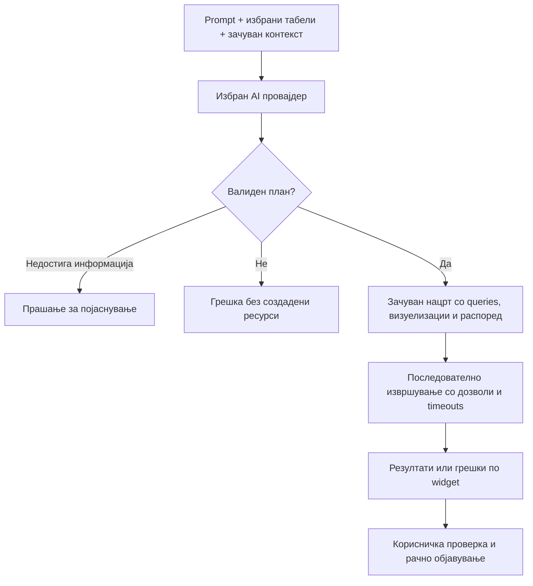

# Bi-Dash — кориснички водич

**За корисници, уредници и администратори · Ажурирано: 8 ноември 2026**

Bi-Dash е работен простор за поврзување бази на податоци, пишување queries, визуелизација и споделување извештаи. Врз open-source основата на Redash се додадени AI асистент, автоматско создавање нацрт-дашборди, избор на AI провајдер, траен деловен контекст и појасни кориснички улоги со ограничувања на извршувањето.

Водичот ја опишува имплементираната верзија на овој проект. Имињата на копчињата се наведени како во англискиот интерфејс. Достапните контроли зависат од твојата улога, групите и политиката на администраторот.

## Содржина

1. [Што е наследено, а што е подобрено](#comparison)
2. [Основни поими](#concepts)
3. [Брз почеток според улогата](#quick-start)
4. [Поврзување извор на податоци](#sources)
5. [Рачно создавање извештај](#manual)
6. [Визуелизации и дашборди](#dashboards)
7. [AI Assistant: Ask AI](#chat)
8. [AI Assistant: Build dashboard](#builder)
9. [Како да напишеш добар prompt](#prompts)
10. [Траен AI Context](#context)
11. [Избор и конфигурирање AI провајдер](#providers)
12. [Admin, Editor и Reader](#roles)
13. [Времетраење, паралелни queries и Limit 1000](#limits)
14. [Освежување, преземање и споделување](#sharing)
15. [Приватност и зачувување на податоците](#privacy)
16. [Решавање проблеми](#troubleshooting)
17. [Препорачан работен процес](#workflow)
18. [Поставување и дополнителна документација](#references)

<a id="comparison"></a>
## 1. Што е наследено, а што е подобрено

Споредбата е со upstream изворот преземен за овој проект на 6 ноември 2026, евидентиран во [UPSTREAM_SOURCE.json](UPSTREAM_SOURCE.json). Не е споредба со секоја Redash верзија, комерцијална понуда или друг fork.

| Област | Наследена основа од Redash | Додадено или подобрено во Bi-Dash |
| --- | --- | --- |
| SQL и извори | Query editor, schema browser и конектори | Постојните врски и работниот процес се задржани; AI builder ја користи достапната шема |
| Извештаи и дашборди | Зачувани queries, визуелизации, widgets и распоред | Создавање вистински нацрт-дашборд со queries и визуелизации од prompt |
| AI разговор | Не е дел од преземената основа | Поголем и почитлив AI панел, објаснување SQL и предлози за queries |
| AI провајдер | Нема ваква конфигурација во преземената основа | Ollama, OpenAI, Anthropic и OpenAI-compatible API преку Settings |
| Деловен контекст | Нема ваква посебна AI секција | Зачуван контекст по организација, автоматски вклучен во AI барањата |
| Пристап | Групи, дозволи за извори и права на ресурси | Експлицитни Admin / Editor / Reader улоги како дополнителна граница на дозволите |
| Reader | Основата користи постојни permissions и групи | Преглед на резултати без SQL, query keys, schema или можност за извршување |
| Editor контроли | Постојни механизми за jobs и deployment timeouts | Организациски и построги кориснички лимити, броење running + queued queries и контроли за AI, scheduling, sharing и archiving |
| Извоз | Наследени формати за преземање | Администраторот може да го исклучи преземањето за Readers |
| Број на редови | Опционален auto-limit во query editor | AI queries немаат дополнителен автоматски лимит; се користи постојниот checkbox по потреба |
| Поставување | Наследена серверска архитектура | Локална Docker конфигурација со PostgreSQL, Redis и Ollama |
| Идентитет | Upstream бренд и ресурси | Bi-Dash интерфејс, Rising Signal лого и соодветни copyright / license известувања |

Стандардните функции — параметри, favorites, tags, освежување, alerts и API — остануваат дел од наследената платформа. Нивната достапност зависи од конекторот, инсталираните компоненти и дозволите. Не се сите нови Bi-Dash функции.

<a id="concepts"></a>
## 2. Основни поими

| Поим | Што значи |
| --- | --- |
| **Data Source** | Конекција кон база или друг поддржан извор. Има адреса, credentials, тип на конектор и групи со пристап |
| **Query** | Зачувано барање до изворот, најчесто SQL, со име и опционални параметри |
| **Result** | Податоците добиени при конкретно извршување. Зачуван резултат може да биде постар од моменталната состојба во базата |
| **Visualization** | Приказ на резултатот: табела, графикон, бројач и слично |
| **Dashboard** | Страница со еден или повеќе widgets, визуелизации и опционален текст |
| **Report / извештај** | Во овој водич: query со визуелизација или дашборд што одговара на деловно прашање; не значи посебен PDF документ |
| **Draft / нацрт** | Необјавен ресурс што треба да се провери. Не претставува посебен приватен простор со сопствен ACL |
| **Role** | Горна граница на дозволените дејства: Admin, Editor или Reader |
| **Group** | Начин да се организира пристапот до извори. Улога не е замена за групниот пристап |

За точен извештај се потребни и технички точен query и правилна деловна дефиниција. На пример, „продажба“ може да значи вкупна сума со ДДВ, нето-приход, платени фактури или потврдени нарачки.

<a id="quick-start"></a>
## 3. Брз почеток според улогата

### Ако си Reader

1. Најави се на адресата на твојата Bi-Dash инсталација.
2. Отвори достапен дашборд од **Dashboards** или директен линк од тимот.
3. Провери кога се освежени резултатите.
4. Прелистувај, сортирај и користи ги достапните филтри во табелата.
5. Преземи резултати преку менито за download ако администраторот го дозволил тоа.

Ако нема зачуван резултат или ти требаат свежи податоци, побарај Editor да го освежи извештајот. Reader не извршува SQL.

### Ако си Editor

1. Провери дали го гледаш потребниот извор и имаш право да извршуваш queries.
2. Создај извештај рачно преку query editor или преку **AI Assistant → Build dashboard**.
3. Провери ги SQL, резултатите, агрегирањето и визуелизациите.
4. Зачувај го извештајот со јасно име и опис.
5. Додај го во дашборд и објави го кога е подготвен и кога имаш право за тоа.

### Ако си Admin

1. Поврзи и тестирај Data Sources.
2. Постави групи и пристап до изворите.
3. Додели улоги преку **Settings → Users**.
4. Постави политика во **Settings → Roles & Access**.
5. Конфигурирај **AI Configuration** и зачувај **AI Context** ако ќе се користи AI.
6. Подготви барем еден проверен извештај со резултати што Readers ќе можат да го отворат.

<a id="sources"></a>
## 4. Поврзување извор на податоци

Овој дел го извршува администратор.

1. Отвори **Settings → Data Sources** и додај извор.
2. Избери соодветен конектор.
3. Внеси разбирливо име, **Host**, **Port**, **User**, **Password** и име на базата, како и SSL поставки ако ги бара серверот.
4. Зачувај и користи **Test Connection**.
5. Додели пристап преку групите.
6. Отвори query editor и провери дали шемата со табели се вчитува.

**MySQL конекторот се користи и со компатибилен MariaDB сервер.** Ознаката MySQL во Bi-Dash е тип на конектор; не е гаранција за точниот производ на оддалечениот сервер. Неговата верзија може да се провери со `SELECT VERSION();` кога конекцијата работи.

**Full access** и **View Only** на изворот се комбинираат со улогата. Reader не добива SQL или право за извршување само затоа што групата има Full access. За AI builder е потребен дозволен, активен извор со query пристап.

Schema browser-от користи кеш. Видлива листа на табели не е доказ дека конекцијата сè уште работи. По промени во шемата, освежи ја; по промена на адреса или credentials, повторно тестирај ја конекцијата.

Нормалниот query editor поддржува повеќе конектори од AI builder-от. AI автоматското создавање моментално е ограничено на PostgreSQL и MySQL/MariaDB.

<a id="manual"></a>
## 5. Рачно создавање извештај

1. Избери **New Query** од менито за создавање.
2. Избери Data Source.
3. Прегледај ги табелите и колоните во schema browser-от.
4. Напиши query за твојот SQL дијалект.
5. Одлучи дали да биде вклучен **Limit 1000**.
6. Изврши го query-то и провери ги резултатите и евентуалните грешки.
7. Зачувај со јасно име, на пример „Месечна нето-продажба — потврдени нарачки“.
8. Додај визуелизација или прикачи ја во дашборд.

**Пример за MySQL/MariaDB со измислена шема** `orders(created_at, status, total)`:

```sql
SELECT
    DATE_FORMAT(created_at, '%Y-%m') AS sales_month,
    SUM(total) AS revenue
FROM orders
WHERE status = 'completed'
GROUP BY DATE_FORMAT(created_at, '%Y-%m')
ORDER BY sales_month;
```

Имињата и статусот во примерот мора да се приспособат на вистинската база. Во PostgreSQL би се користеле соодветни функции како `date_trunc`; SQL не е автоматски пренослив меѓу сите конектори.

Пред зачувување провери: кој период е вклучен, која временска зона се користи, дали сумите се со ДДВ, како се третираат сторнирања и дали JOIN-овите ги дуплираат износите.

<a id="dashboards"></a>
## 6. Визуелизации и дашборди

Рачно можеш да ги користиш визуелизациите што ги нуди инсталацијата. AI builder создава подмножество од нив:

| Приказ | Кога е корисен |
| --- | --- |
| **Table** | Детални редови, проверка на податоци, листи и рангирања |
| **Bar** | Споредба по производ, категорија, продавница или друг сегмент |
| **Line** | Движење низ време, со правилен временски редослед |
| **Pie** | Удели од целина со мал број категории |
| **Counter** | Една бројчена вредност, на пример вкупна продажба или број нарачки |

Во editor-от на визуелизацијата избери ја категоријата/датумот за X и бројчените колони за Y. Постави формат на броеви, легенда, наслови и други достапни опции. Ако имаш повеќе валути, не собирај ги во еден counter без дефинирано претворање.

За рачен дашборд создај **New Dashboard**, додај зачувани визуелизации, намести распоред и димензии, додај опис или текст и зачувај. Различни widgets може да доаѓаат од различни извори; корисникот мора да има соодветен пристап за нивните податоци.

Објавувањето на дашборд и создавањето **public link** се различни дејства. Public sharing е посебна дозвола; необјавен нацрт не значи дека само авторот може да го види.

<a id="chat"></a>
## 7. AI Assistant: Ask AI

**Ask AI** е разговор за SQL, анализа на query и објаснување на пристап. Сам по себе не создава дашборд и не ги извршува предложените queries.

1. Отвори **AI Assistant** и избери **Ask AI**.
2. Напиши конкретно прашање.
3. По потреба отвори **Extra context for this conversation** и додај релевантна шема или детали.
4. Испрати со **Send** или **Ctrl / ⌘ + Enter**.
5. Прочитај го одговорот. Ако користиш SQL од него, провери го пред да го извршиш во query editor.

Примери:

> Објасни зошто овој JOIN може да ја дуплира продажбата. Не менувај ги имињата на табелите.

> За MySQL напиши query за дневна продажба од потврдени нарачки. Користи ја приложената шема и прашај ме ако недостига дефиниција за износот.

**Copy SQL / answer** го копира SQL блокот, кога е препознаен, или одговорот. **Clear chat** го чисти разговорот. Разговорот во панелот се губи при reload; зачуваниот организациски AI Context останува.

AI не добива автоматски целосен увид во базата преку chat. Тој одговара врз основа на испратеното прашање и контекстот. Точноста зависи и од избраниот модел.

<a id="builder"></a>
## 8. AI Assistant: Build dashboard

Ова е начинот да добиеш вистински извештај без рачно копирање SQL од одговорот.

### Постапка

1. Отвори **AI Assistant → Build dashboard**.
2. Избери Data Source. Се прикажуваат достапните активни PostgreSQL и MySQL/MariaDB извори со соодветен пристап.
3. Во **Relevant tables** избери ги табелите потребни за извештајот, најмногу **12**. Точните имиња и колони од кешираната шема се додаваат автоматски.
4. Опиши ги метриките, периодот, групирањето, филтрите и посакуваните визуелизации.
5. Притисни **Create draft dashboard** и почекај.
6. Прегледај го статусот на секој query: preparing, queued, running, ready или конкретна грешка.
7. Отвори **Open draft dashboard**.
8. Провери SQL, податоци, графикони и деловни претпоставки. По потреба уреди ги и потоа објави.

### Што се случува во позадина



Моделот предлага структуриран план; Bi-Dash го валидира и ги создава ресурсите. Се проверуваат дозволите и по одговорот од AI. Автоматските queries се единечни read-only SELECT/CTE statements со ограничен список поддржани функции, а конекторот користи read-only трансакција. Невалиден план не создава делумен дашборд.

### Можности и граници

- До **6 визуелизации** во едно генерирање: table, bar, line, pie или counter.
- Builder-от не објавува, не закажува и не создава public link автоматски.
- Нема вграден автоматски лимит од 1.000 редови. Новите AI queries се создаваат со исклучен auto-limit. Checkbox-от во query editor се користи по потреба.
- Изречно побарано „top 10“ или друг SQL `LIMIT` има свое значење и не се отстранува со исклучување на checkbox-от.
- Секој AI query има максимум **60 секунди**, или пократкиот важечки кориснички/deployment лимит.
- Избраните табели го насочуваат моделот; не се нова безбедносна граница. Вистинската авторизација доаѓа од дозволите во Bi-Dash и credentials на базата.
- Ако очекуваните имиња на chart колоните не се совпаѓаат со резултатот, builder-от може да ја замени визуелизацијата со табела и да го прикаже тоа во статусот.

### Ако еден query не успее

Веќе создадениот нацрт останува зачуван, а грешката се прикажува кај конкретниот widget. Поправи ја причината и користи **Retry report results** или отвори го query-то во editor. Retry ги повторува извршувањата на тој нацрт; не создава втор дашборд со истиот request ID. Нов prompt или нова сесија може да создаде нов нацрт.

Остави ја страницата отворена додека траат генерирањето и последователните извршувања. Затворање на drawer-от ја задржува неговата состојба, но reload или навигација може да ги прекине преостанатите чекори во прелистувачот. Веќе зачуваните ресурси и започнатите jobs остануваат.

<a id="prompts"></a>
## 9. Како да напишеш добар prompt

Добар prompt содржи: **метрика + период + филтри + групирање + приказ + дефиниции што не смеат да се претпостават**.

### Пример: месечна, неделна и дневна продажба

> Создај дашборд со три линиски графикони за месечна, неделна и дневна нето-продажба за 2026 година. Вклучи само потврдени нарачки. Исклучи откажани нарачки и одземи ги сторнирањата според зачуваниот контекст. Неделата почнува во понеделник. Користи ја деловната временска зона Europe/Skopje. Прикажи датуми по растечки редослед. Не додавај ограничување на бројот на редови. Ако шемата или контекстот не ја дефинираат нето-продажбата, прашај пред да го составиш планот.

Ова е барање до моделот, не гаранција дека неделното групирање или конверзијата на временска зона ќе бидат точни без проверка. Потребните колони и дефиниции мора да постојат.

### Пример: управувачки преглед

> Направи нацрт со counter за вкупен нето-приход во избраниот период, bar chart по категорија и табела со top 10 производи по приход. Прикажи ги износите во иста валута. Не мешај број на производи со број на нарачки.

### Пример: проверка на податоци

> Создај табела со дневен број нарачки и вкупен износ. Вклучи и број на редови без датум. Не претпоставувај JOIN ако врската меѓу избраните табели не е дефинирана во контекстот.

Избегнувај само „направи продажба со график“. Со мал локален модел побарај помал број widgets и избери само релевантни табели. Не барај функции надвор од поддршката на builder-от; посложен SQL можеш да го разработиш преку Ask AI и рачно да го провериш.

<a id="context"></a>
## 10. Траен AI Context

**Settings → AI Context** е посебна администраторска секција за заеднички деловни дефиниции. Контекстот се зачувува по организација, важи и за chat и за builder и останува по рестарт. Лимитот на зачуван текст е **24.000 знаци**, но големината што моделот може да ја обработи зависи од неговиот context window.

Пример за контекст што треба да се приспособи на вистинската база:

```text
SQL дијалект: MySQL/MariaDB.
Сите имиња на табели и нивните префикси мора да се зачуваат точно.

Продажба = нето-износ од потврдени нарачки.
Откажаните нарачки не се вклучуваат.
Нето-износот е без ДДВ. Валута: MKD.
Дефиницијата за сторнирања е: [внеси точна деловна логика].

Неделата почнува во понеделник.
Датумите во базата се чуваат во: [внеси вистинска временска зона].
Врската меѓу нарачка и ставки е: [табела.клуч = табела.клуч].

Ако недостига дефиниција, постави прашање. Не измислувај колони или врски.
```

Не оставај ги placeholder-ите од примерот како реални дефиниции. Внеси точни имиња на износи, статуси и клучеви. Контекстот е насока за моделот, а не доделување пристап или заштита на база. Не внесувај лозинки, API keys или непотребни лични податоци.

Дополнителниот контекст во Ask AI е за тековниот разговор. Не го заменува трајниот организациски контекст и не се зачувува како негово ажурирање.

<a id="providers"></a>
## 11. Избор и конфигурирање AI провајдер

Администратор отвора **Settings → AI Configuration**, избира провајдер, внесува точен **Model ID**, адреса кога е применливо и сопствен **API key** кога е потребен, па притиска **Save**.

| Опција | Што се внесува | Кога е соодветна |
| --- | --- | --- |
| **Ollama** | Инсталиран Model ID и адреса достапна од серверот | Локално извршување на моделот, без платен API key |
| **OpenAI** | Model ID што го нуди сметката и сопствен API key | Hosted модел со провајдерска наплата |
| **Anthropic** | Соодветен Claude Model ID и сопствен API key | Hosted модел со провајдерска наплата |
| **Other / OpenAI-compatible** | Model ID, API base URL и опционален key според сервисот | Компатибилен локален сервер, gateway или hosted API |

Оваа флексибилност е на ниво на API протокол. Не значи дека секој произволен agent endpoint може да се користи без адаптер. Compatible опцијата очекува OpenAI Chat Completions-compatible интерфејс.

За compatible сервис внеси base URL со верзиската патека, на пример `https://provider.example/v1`, **без** `/chat/completions`: Bi-Dash ја додава таа патека. `.example` е илустративна адреса, не провајдер што може да се користи.

За Ollama во локалниот Docker состав адресата е `http://ollama:11434`. За Ollama на Windows host, контејнерот вообичаено користи `http://host.docker.internal:11434`. `localhost` во контејнер не значи твојот Windows host.

Моделот мора да биде достапен: внесување име во Settings не го презема моделот. За моделот користен во локалната поставеност:

```powershell
docker compose -f compose.local.yaml exec ollama ollama pull qwen2.5-coder:7b
```

Профилите се зачувуваат при менување провајдер. Празно поле за key го задржува претходно зачуваниот key за истиот профил; нов key го заменува, а **Remove the saved API key** го отстранува. При промена на compatible base URL се бара повторно внесување key за да не се испрати стариот на друга адреса.

Изборот е експлицитен: ако Ollama не работи, Bi-Dash не преминува автоматски на платен провајдер. Hosted профил бара важечки credentials и достапна квота кај провајдерот. Проектот не содржи туѓ API key или бесплатна hosted сметка.

<a id="roles"></a>
## 12. Admin, Editor и Reader

| Функција | Admin | Editor | Reader |
| --- | --- | --- | --- |
| Управување корисници, улоги, извори и AI поставки | Да, во организацијата | Не | Не |
| Преглед на SQL и schema | Да | Според пристапот до изворот | Не |
| Создавање и уредување извештаи | Да | Сопствени или со дозволен edit пристап | Не |
| Преглед на достапни резултати | Да | Да | Да |
| Свежо извршување query | Да, со важечки deployment лимити | Со важечки лимити и пристап | Не |
| Download | Да | Да | Стандардно да; Admin може да го исклучи |
| AI Assistant и builder | Да | Стандардно дозволено; Admin може да го исклучи; останатите дозволи сè уште важат | Не |
| Scheduling / public sharing / archiving | Да | Стандардно исклучени; се конфигурираат од Admin | Не |

### Доделување улоги

Во **Settings → Users** избери улога при создавање корисник, или отвори профил и **Role & query limits**. Зачувај ги промените. Новите покани стандардно се Reader; новите SSO корисници исто така почнуваат како Reader и Admin може да ги промовира.

Постојните сметки без експлицитна улога се толкуваат според наследените групи: Admin ако имаат admin дозвола, инаку Editor. Тоа е правило за компатибилност, а не причина да не се проверат старите сметки.

Групниот пристап не може да ја надмине експлицитната улога. Reader во административна група не станува Admin. Editor не може сам да си додели повисока улога или да доделува edit grants на други корисници. Администраторот управува со тие дозволи.

### Што точно гледа Reader

Reader добива резултати, не SQL, query hashes или query API keys. Нема пристап до query листи со SQL, schema browser, query snippets, AI и modification endpoints. Ограничувањето е и во backend, не само сокриено копче.

Reader работи со претходно пресметани резултати. Paging, sorting и table filters се однесуваат на вчитаните податоци. Промена на параметри може да врати зачуван резултат за таа точна комбинација; ако нема таков резултат, потребно е Editor да го изврши query-то. Reader не создава нов database job преку refresh.

Исклучувањето download не го отстранува пристапот до дозволените податоци во извештајот; корисникот и понатаму може да ги чита преку нормалниот интерфејс/API.

<a id="limits"></a>
## 13. Времетраење, паралелни queries и Limit 1000

Овие три контроли решаваат различни проблеми:

| Контрола | Што ограничува | Стандард / опсег |
| --- | --- | --- |
| **Maximum query duration** | Колку долго смее да трае едно извршување | Editor: 60 секунди; организациска поставка 1–3.600 секунди |
| **Maximum concurrent queries** | Колку jobs на еден корисник смеат да бидат running или queued | Editor: 2; организациска поставка 1–20 |
| **Limit 1000** | Опционален auto-limit во query editor | Кориснички избор за query-то; не е дополнителен хардкодиран AI лимит |

Admin ги поставува првите две контроли во **Settings → Roles & Access**. Во профил може да додели построги вредности за конкретен Editor; празни полиња ја наследуваат политиката. Поголема индивидуална вредност не може да олабави построг организациски лимит.

Пример: организацијата дозволува 60 секунди и 2 jobs. За нов Editor се поставуваат 20 секунди и 1 job. Важи 20/1. Ако профилот има 120 секунди, организацискиот лимит од 60 и понатаму важи. AI builder има сопствен максимум од 60 секунди, дури и ако обичните queries на корисникот смеат подолго.

Во квотата влегуваат и queued jobs; два queued queries може да го зафатат целиот лимит од 2. HTTP 429 значи дека треба да почекаш или да откажеш сопствена работа кога таа опција е достапна.

При timeout worker-от го прекинува job-от; PostgreSQL добива и native statement timeout. За други конектори однесувањето на оддалечениот сервер зависи од неговиот cancellation механизам. Овие контроли не ги поништуваат дејствата што веќе завршиле. Промена на политиката не го скратува ретроактивно timeout-от на job што веќе е примен.

**Limit 1000** не е timeout и не гарантира евтино пресметување: query со мал резултат може да скенира многу податоци. Исклучување на checkbox не отстранува `LIMIT` што е веќе напишан во SQL и не ги враќа редовите што ги отстраниле WHERE, GROUP BY или други услови. По промена на поставката повторно изврши и зачувај го query-то за да добиеш соодветни свежи резултати.

<a id="sharing"></a>
## 14. Освежување, преземање и споделување

### Свежина и параметри

Зачуван дашборд може да прикажува последни резултати. Провери го времето на освежување пред одлука. Editor/Admin со дозволен извор може да изврши свежо query; Reader користи достапни зачувани резултати.

Ако користиш query parameters, дефинирај ги во editor и избери соодветни типови. Builder-от првично генерира queries без параметри; подоцнежното рачно уредување следи според стандардните правила на платформата.

### Download

Преку менито на query/визуелизацијата, кога е достапно, преземи **CSV**, **TSV** или **Excel (.xlsx)**. Се извезува конкретниот query result, не автоматски целата база и не screenshot од целиот дашборд. Ако резултатот бил ограничен со SQL или со auto-limit, download нема да ги реконструира отсечените редови.

### Внатрешно споделување

Сподели линк до извештај или дашборд со членови на организацијата. Линкот не им доделува пристап до извор за кој немаат дозвола. За уредување туѓ ресурс потребен е соодветен edit grant од Admin.

### Public links и scheduling

Public sharing е посебна можност, не исто што и **Publish** на нацрт. Користи го само кога е дозволено и кога резултатите се наменети за тој начин на пристап. Editor стандардно нема public sharing, scheduling или archiving; Admin може да ги дозволи одделно.

Scheduled refresh е закажано извршување query, а не автоматско генерирање нов AI план. Се проверува дали сопственикот и понатаму има право за scheduling. Alerts и destinations се конфигурираат одделно; работат според инсталираните интеграции и дозволите.

<a id="privacy"></a>
## 15. Приватност и зачувување на податоците

- **AI provider:** се испраќаат prompt, вклучен контекст и релевантна шема. Chat ќе ја испрати и содржината што самиот ќе ја залепиш во разговорот. Builder-от не ги враќа добиените query result rows до моделот.
- **Локален модел:** Ollama е локален само ако конфигурираниот endpoint навистина е локален. Внесена оддалечена адреса испраќа барања таму.
- **Hosted модел:** обработката, задржувањето и наплатата зависат од провајдерот и договорот за твојата сметка.
- **API keys:** зачуваните keys се криптираат на серверот и не се враќаат како plaintext во Settings. При backup/restore мора да се зачува соодветниот серверски secret за да можат да се дешифрираат.
- **Drafts:** остануваат ресурс на организацијата со нормални правила за пристап. „Unpublished“ не е гаранција за авторска приватност.
- **Локално Docker складирање:** PostgreSQL volume ги чува корисниците, извештаите и поставките; Ollama volume ги чува моделите. Разговорот во drawer не е трајна chat историја.
- **Usage data:** наследената опционална телеметрија е одделна од AI и, кога е овозможена, оди до upstream analytics endpoint. Интерфејсот го наведува вистинскиот примач; ова не е Bi-Dash hosted analytics услуга.

При backup не се доволни само source code и GitHub. Потребни се metadata базата и релевантните server secrets/configuration. Не објавувај `.env`, database dumps, приватни keys или реални credentials во GitHub.

<a id="troubleshooting"></a>
## 16. Решавање проблеми

| Симптом | Што значи / следен чекор |
| --- | --- |
| **Host is not allowed / 1130** | Серверот ја одбил конекцијата од прикажаната клиентска адреса. Провери го вистинскиот database Host, дозволениот пристап и дали провајдерот сменил IP. Адресата на базата и адресата од која доаѓа клиентот се различни улоги |
| **Access denied** | Провери user/password, database, host-specific grants и SSL барања. Не додавај credentials во AI Context |
| Табелите се видливи, но query не работи | Шемата може да е кеширана. Пушти Test Connection и провери го source/worker пристапот |
| Изворот не е во Build dashboard | Провери тип PostgreSQL/MySQL, paused состојба, улога, AI дозвола и Full query пристап преку група |
| Не може да се вчита schema | Провери конекција, schema worker и достапност на табелите за database корисникот |
| **AI provider is not configured** | Admin треба да зачува валиден провајдер, Model ID, URL и key кога е потребен |
| Provider error / 502 | Провери endpoint достапен од Bi-Dash серверот, Model ID, API протокол и provider статус; прочитај ја конкретната порака |
| AI timeout / 504 | Моделот не одговорил во дозволениот рок. Намали контекст/табели/widgets и провери CPU/RAM; Admin нека ги провери AI и web-worker timeout поставките |
| **429 / query limit reached** | Почекај да заврши running/queued работа. Одделен 429 од hosted AI може да значи rate limit или недостапна квота кај провајдерот |
| Query timeout | Скрати период, оптимизирај JOIN/услови, провери индекси или побарај Admin да ја прегледа политиката |
| Невалиден AI план | Моделот не вратил поддржана структура/SQL. Прецизирај prompt, користи помал број widgets или посоодветен модел |
| Еден widget е со грешка | Нацртот останува. Отвори го query-то и провери SQL/конекција; потоа retry или рачно извршување |
| Графиконот станал табела | Output aliases не се совпаѓале со очекуваните chart колони. Постави соодветна визуелизација по проверка на резултатот |
| Reader не добива свежи податоци | Потребен е Editor/Admin да го пресмета резултатот, вклучувајќи ја бараната комбинација параметри |
| Download недостига | Провери Reader download policy и дали има достапен резултат |
| И понатаму има 1.000 редови | Провери Limit 1000, SQL LIMIT и дали гледаш стар резултат. Повторно изврши по промена |
| Бројките се погрешни без техничка грешка | Провери дефиниции, timezone, статуси, валути, сторнирања и дуплирање од JOIN. Успешно извршување не ја докажува деловната точност |
| Се гледа старо лого или стари контроли | Освежи со Ctrl+Shift+R. По промена на улога, reload ја усогласува видливоста на контролите со новите дозволи |

Кога пријавуваш проблем, наведи ги улогата, името/ID на извештајот, времето, точната порака и релевантен prompt/SQL без тајни. Кажи дали **Test Connection** работи и дали проблемот постои и без AI.

<a id="workflow"></a>
## 17. Препорачан работен процес

1. **Admin:** поврзува извор, тестира пристап и дефинира групи и улоги.
2. **Тимот:** ги усогласува значењата на метриките, статусите и временските зони.
3. **Admin:** го зачувува усогласениот AI Context и го избира провајдерот.
4. **Editor:** создава мал, јасно дефиниран нацрт рачно или со AI.
5. **Editor:** ги споредува резултатите со познат период или референтен извештај и ги проверува JOIN-овите.
6. **Editor/Admin:** уредува наслови, формати, опис, распоред и права; потоа го објавува проверениот дашборд.
7. **Reader:** користи резултати, прелистува и презема кога е дозволено.
8. **Admin:** ја следи политиката за оптоварување, пристап и освежување според реалните потреби.

За пилот користи една метрика и еден графикон. Кога тие се потврдени, прошири на повеќе widgets. Така грешките во деловната логика полесно се забележуваат.

<a id="references"></a>
## 18. Поставување и дополнителна документација

За нова локална Windows инсталација следи [README.md](README.md) и [LOCAL_PROJECT.md](LOCAL_PROJECT.md). Потребни се Docker Desktop со Linux containers и ресурсите за избраниот модел. Локалниот состав го отвора Bi-Dash на `http://localhost:5001`; кај друга инсталација користи ја адресата што ја дал администраторот.

| Документ | Намена |
| --- | --- |
| [README.md](README.md) | Почетна страница и локално стартување |
| [AI_DASHBOARDS.md](AI_DASHBOARDS.md) | Технички детали и граници на автоматското создавање |
| [ACCESS_CONTROL.md](ACCESS_CONTROL.md) | Улоги, quotas, API однесување и cancellation |
| [LOCAL_PROJECT.md](LOCAL_PROJECT.md) | Конфигурација, локална архитектура, ресурси и проверки |
| [docs/user-guide](docs/user-guide) | Подетални наследени/приспособени упатства за querying, dashboards и други функции |
| [BRANDING.md](BRANDING.md) и [branding](branding) | Визуелен идентитет и logo assets |
| [LICENSE](LICENSE), [NOTICE](NOTICE), [COPYRIGHT.md](COPYRIGHT.md) | Лиценци и опсег на авторските известувања |
| [SECURITY.md](SECURITY.md) | Пријавување безбедносни проблеми |

Техничките `REDASH_*` environment имиња и внатрешните package имиња се задржани за компатибилност. Тие не значат дека е вчитана друга апликација. Историските upstream известувања и third-party права остануваат со своите вистински имиња.

Оригинални Bi-Dash придонеси: © 2026 Slavcho Spasenoski, во опсегот заштитен со применливото право. Bi-Dash е изведен од upstream Redash; лиценцата и соодветните атрибуции се зачувани.
